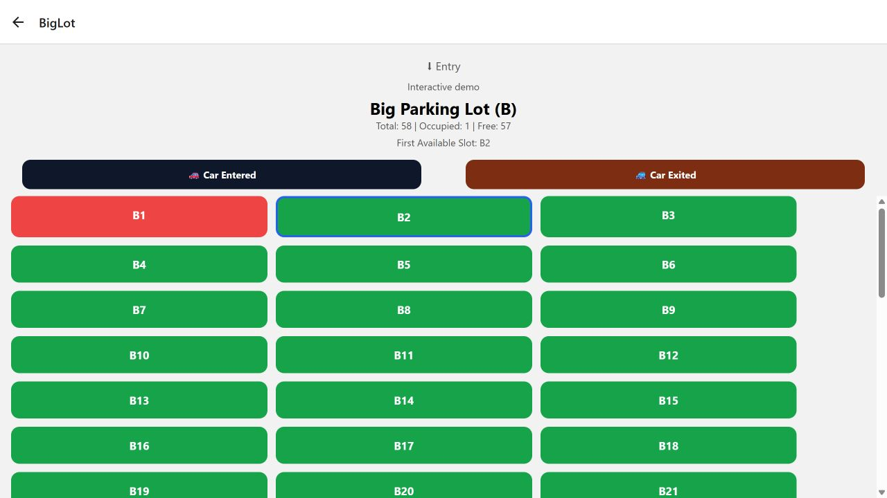
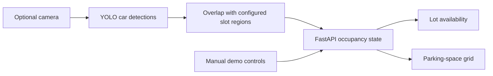

# Smart Parking

A parking-availability prototype connecting a React Native/Expo interface to a FastAPI backend, with an optional YOLO/OpenCV camera detector.

The current app supports **one lot with 58 example spaces**. It can run as an interactive manual demo without a camera or model download. Camera mode uses car detections to estimate occupancy in predefined image regions; those regions still need calibration for a real parking view.

## Demo



This screenshot shows manually controlled demo occupancy, not measured camera detections.

## Implemented scope

- Home screen showing available and total spaces for Parking B.
- Parking-space grid with occupied/free colors and the first available space highlighted.
- Entry and exit buttons that update the API in manual-demo mode.
- Polling to update the lot view and home summary.
- Configurable API address and connection-error messages.
- Optional camera processing using the COCO car class, confidence threshold 0.4 and rectangle overlap.
- Complete detection snapshots published under a lock, rather than exposing a frame's partially reset state.
- Detector status reporting and rejection of manual writes while camera mode is enabled.

“First available” means the first free slot in the configured ordering. No distance calculation, navigation route or reservation system is implemented.

## Architecture



Camera detection and manual updates are separate modes. Both use in-memory state; restarting the backend resets it. Run a single backend worker for this prototype.

## Run the manual demo

Use Python 3.11 and a Node.js version compatible with the included Expo SDK 54 dependencies. The frontend dependency versions are recorded in `package-lock.json`.

From the repository root, create a Python environment and start the API. On Windows PowerShell:

```powershell
py -3.11 -m venv .venv
.\.venv\Scripts\python -m pip install -r backend/requirements.txt
$env:PARKING_DETECTION_ENABLED = "0"
.\.venv\Scripts\python -m uvicorn backend.server:app --host 127.0.0.1 --port 8000
```

In a second terminal:

```powershell
npm ci
Copy-Item .env.example .env
npm run web
```

The example API address is `http://localhost:8000`. Open **View spaces**, press **Car Entered**, and check that the occupied count increases and the first available slot advances. Press **Car Exited** to reverse the update. Returning to Home refreshes the summary.

For a physical phone, set `EXPO_PUBLIC_API_URL` in `.env` to this computer's reachable LAN address, bind the API to that LAN interface, and restart Expo. A phone's `localhost` refers to the phone itself. `npm start` starts Expo for device development. Native Android/iOS behavior has not been tested during preparation.

## Optional camera mode

Install the extra dependencies and configure the intended camera before enabling it:

```powershell
.\.venv\Scripts\python -m pip install -r backend/requirements-vision.txt
$env:PARKING_DETECTION_ENABLED = "1"
$env:PARKING_CAMERA_INDEX = "1"
.\.venv\Scripts\python -m uvicorn backend.server:app --host 127.0.0.1 --port 8000
```

The default model path is `backend/yolov8n.pt`; `PARKING_MODEL_PATH` can override it. Model weights are excluded from this repository. Ultralytics may download its pretrained weights on first use. The project uses a pretrained detector; it does not include custom model training or claim ownership of those weights. External dependencies and weights retain their respective licenses.

Before interpreting occupancy, replace `SLOTS` in `backend/server.py` with regions calibrated to your camera frame. The original 58-slot rectangular grid is example geometry: some regions can be outside the frame. Any overlap can mark a slot occupied, so one large car box may mark multiple spaces. Only COCO class 2 (car) is used; other vehicle classes are ignored.

Live camera/model startup, detection accuracy and real parking performance remain unverified. If the detector is not running, the UI reports that availability is unverified. The older `backend/yolo_webcam_live.py` is a standalone webcam preview experiment with its own settings; it is not the app backend.

## API

| Method | Route | Behavior |
| --- | --- | --- |
| GET | `/` | Mode and detector status |
| GET | `/biglot` | Slot-state snapshot, mode and detector status |
| POST | `/slot/{slot_id}/{state}` | Set `free` or `occupied` in manual-demo mode |

Unknown slots return 404, invalid states return 400, and manual writes in camera mode return 409. Interactive API documentation is available at `/docs` while the server is running.

## Verification

```powershell
.\.venv\Scripts\python -m pip install -r backend/requirements-test.txt
.\.venv\Scripts\python -m unittest discover -s tests -v
npm run lint
npx expo export --platform web
```

Seven API/mapping checks pass. Frontend lint and a web export pass. Browser verification covers navigation, occupancy display and manual entry/exit updates. See [verification notes](docs/verification.md) for the exact scope and environment.

## Limits and development work

This is a local prototype with no authentication, persistent storage, reservations or multi-worker synchronization. Its permissive CORS settings and unauthenticated write endpoint are intended for controlled local development. Camera calibration and representative video evaluation are the main next steps. Phone testing and improved responsive layout/animation are also pending.

## Source history

The first commit preserves the available original application source. A separate preparation commit adds portable configuration, a camera-free demo, API checks and documentation, removes links to unimplemented lots and removes unused sample slot data. The original working folder was not edited. The app began from an Expo starter; starter artwork is not presented as original project design.
